# BAND 4 BAND : The Materials Science Discovery & Comparison Platform

<p align="center">
  <strong>Compare Materials. Challenge Assumptions. Discover Better Candidates.</strong>
</p>

<p align="center">
  A scientific materials intelligence platform combining materials comparison, computational materials data, multi-objective optimization, crystal structure inspection, electronic band analysis, scientific validation, and gamified research.
</p>

<p align="center">
  
  
  
  
</p>


---

# TABLE OF CONTENTS

1. [Project Overview](#1-project-overview)
2. [The Problem](#2-the-problem)
3. [The BAND FOR BAND Solution](#3-the-band-for-band-solution)
4. [Core Platform Capabilities](#4-core-platform-capabilities)
5. [System Architecture](#5-system-architecture)
6. [Technology Stack](#6-technology-stack)
7. [Application Architecture](#7-application-architecture)
8. [Materials Data Architecture](#8-materials-data-architecture)
9. [Materials Comparison Engine](#9-materials-comparison-engine)
10. [Multi-Objective Optimization](#10-multi-objective-optimization)
11. [Pareto Frontier Analysis](#11-pareto-frontier-analysis)
12. [Uncertainty and Scientific Validation](#12-uncertainty-and-scientific-validation)
13. [Crystal Structure Inspector](#13-crystal-structure-inspector)
14. [Electronic Band Structure Analysis](#14-electronic-band-structure-analysis)
15. [Research Module Architecture](#15-research-module-architecture)
16. [Gamification and Research Missions](#16-gamification-and-research-missions)
17. [API Reference](#17-api-reference)
18. [Data Sources and Integrations](#18-data-sources-and-integrations)
19. [Installation and Local Development](#19-installation-and-local-development)
20. [Testing, Deployment, and Future Development](#20-testing-deployment-and-future-development)

---

# 1. PROJECT OVERVIEW

## 1.1 What is BAND FOR BAND?

**BAND FOR BAND** is a materials science discovery and comparison platform designed to make the evaluation of advanced materials more interactive, explainable, and accessible.

The platform allows users to compare candidate materials across scientific properties, investigate electronic and structural characteristics, inspect research provenance, and evaluate trade-offs between competing material objectives.

Instead of presenting a material as a single score, BAND FOR BAND treats material selection as a multi-dimensional scientific problem.

A semiconductor might have:

- A desirable band gap.
- High thermal conductivity.
- Low carrier mobility.
- High density.
- Expensive or difficult processing requirements.
- Uncertain experimental measurements.

A single ranking cannot adequately represent all of these considerations.

BAND FOR BAND makes those trade-offs visible.

The platform combines:

- Materials property comparison.
- Semiconductor property analysis.
- Crystal structure inspection.
- Electronic band data analysis.
- Computational and experimental evidence tracking.
- Multi-objective optimization.
- Pareto-front analysis.
- Uncertainty-aware candidate screening.
- Scientific validation modules.
- Gamified research challenges.

The result is an interactive materials research environment that helps users understand not only which candidate performs well, but also why it performs well and where its limitations exist.

## 1.2 Product vision

The long-term vision is to create an accessible materials discovery environment where users can move from a scientific question to a structured comparison, investigate candidate properties, validate supporting evidence, and identify promising materials for further research.

The platform is designed around five principles:

1. **Scientific transparency:** Every property should have a traceable source, unit, method, and context whenever that information is available.
2. **Comparability:** Materials should be evaluated under compatible conditions.
3. **Explainability:** Rankings should expose their assumptions and mathematical methodology.
4. **Reproducibility:** Research workflows should be structured and repeatable.
5. **Accessibility:** Scientific exploration should be engaging without sacrificing technical accuracy.

## 1.3 Intended users

| User | Primary use case |
|---|---|
| Materials science students | Explore material properties and scientific relationships |
| Semiconductor researchers | Compare electronic and transport properties |
| Computational materials scientists | Inspect computational data and methodology |
| Research engineers | Screen candidate materials against design requirements |
| Educators | Create interactive materials science challenges |
| Hackathon participants | Demonstrate scientific software and discovery workflows |
| Materials enthusiasts | Explore the relationships between material composition and performance |

## 1.4 Platform at a glance

| Capability | Description |
|---|---|
| Material comparison | Side-by-side scientific property comparison |
| Crystal inspection | CIF-based lattice and atomic coordinate inspection |
| Band analysis | Analyze supplied electronic band energy arrays |
| Optimization | Rank candidates against multiple objectives |
| Pareto analysis | Identify non-dominated candidate materials |
| Evidence auditing | Review source and methodology metadata |
| Uncertainty analysis | Track uncertainty and replicate information |
| Research modules | 500 expansion validation modules |
| Research missions | Structured scientific challenges |
| Demo environment | Synthetic datasets for reproducible demonstrations |

---

# 2. THE PROBLEM

## 2.1 Materials discovery involves competing objectives

Modern materials research rarely involves optimizing a single property.

For example, semiconductor selection can involve:

- Band gap.
- Carrier mobility.
- Effective mass.
- Dielectric properties.
- Thermal conductivity.
- Defect tolerance.
- Crystal stability.
- Manufacturing compatibility.

The material with the highest value in one property may not be the best candidate overall.

Consider a hypothetical semiconductor screening problem:

| Property | Candidate A | Candidate B | Candidate C |
|---|---:|---:|---:|
| Band gap | 2.1 eV | 1.6 eV | 2.5 eV |
| Thermal conductivity | 120 | 190 | 85 |
| Density | 4.2 | 5.1 | 3.2 |

These are illustrative synthetic values.

Candidate A may offer a balanced combination of properties. Candidate B may offer higher thermal conductivity. Candidate C may offer a larger band gap and lower density.

There is no universally correct winner without defining the intended application and its constraints.

BAND FOR BAND makes those trade-offs explicit.

## 2.2 Fragmented scientific information

Materials properties can originate from different sources:

- Experimental publications.
- Computational materials databases.
- Density functional theory calculations.
- Laboratory measurements.
- Scientific supplementary information.
- Research datasets.
- User-supplied calculations.

These sources can differ in:

- Measurement temperature.
- Pressure.
- Crystal phase.
- Defect concentration.
- Computational approximation.
- Functional selection.
- Unit conventions.
- Measurement uncertainty.

Comparing values without their associated context can produce misleading conclusions.

## 2.3 Scientific data quality is part of the discovery problem

A property value is not sufficient by itself.

A useful scientific record should ideally include:

```text
Material
  |
  +-- Property
  |     |
  |     +-- Value
  |     +-- Unit
  |     +-- Uncertainty
  |     +-- Measurement conditions
  |
  +-- Evidence
        |
        +-- Source
        +-- Method
        +-- Dataset identifier
        +-- Retrieval date
        +-- Validation status
```

BAND FOR BAND therefore treats scientific provenance and validation as core product features rather than optional administrative information.

## 2.4 Why existing comparison approaches are insufficient

Simple comparison tables are useful, but they often lack:

- Explicit objective weighting.
- Multi-objective trade-off visualization.
- Pareto dominance analysis.
- Missing-data handling.
- Uncertainty metadata.
- Computational provenance.
- Experimental condition tracking.
- Reproducible screening workflows.

BAND FOR BAND combines these capabilities into a unified workflow.

---

# 3. THE BAND FOR BAND SOLUTION

## 3.1 The research workflow

The platform follows a structured discovery process.

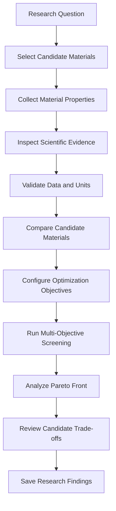

The workflow connects scientific data to an interpretable discovery process.

## 3.2 From comparison to discovery

Traditional comparison:

```text
Material A vs Material B
```

BAND FOR BAND comparison:

```text
Material A
    |
    +-- Electronic properties
    +-- Crystal properties
    +-- Thermal properties
    +-- Mechanical properties
    +-- Experimental evidence
    +-- Computational evidence
    +-- Uncertainty

Material B
    |
    +-- Electronic properties
    +-- Crystal properties
    +-- Thermal properties
    +-- Mechanical properties
    +-- Experimental evidence
    +-- Computational evidence
    +-- Uncertainty

                 |
                 v

        Scientific comparison
                 |
                 v

        Multi-objective screening
                 |
                 v

        Pareto candidate analysis
```

## 3.3 Product philosophy

The platform does not assume that a higher numerical score always means a better material.

Instead, it distinguishes between:

- Raw scientific measurements.
- Computed or predicted properties.
- Normalized comparison scores.
- User-defined objective weights.
- Uncertainty estimates.
- Candidate selection decisions.

This distinction is essential for scientific integrity.

---

# 4. CORE PLATFORM CAPABILITIES

## 4.1 Materials comparison

The comparison engine presents multiple materials side by side.

Supported property categories include:

**Electronic properties**
- Band gap.
- Fermi level.
- Valence band maximum.
- Conduction band minimum.
- Electron effective mass.
- Hole effective mass.

**Transport properties**
- Electron mobility.
- Hole mobility.
- Electrical conductivity.
- Resistivity.

**Thermal properties**
- Thermal conductivity.
- Heat capacity.
- Debye temperature.
- Melting temperature.

**Crystal properties**
- Lattice parameters.
- Lattice angles.
- Unit cell volume.
- Atom count.
- Space group.

**Mechanical properties**
- Bulk modulus.
- Shear modulus.
- Young's modulus.
- Poisson ratio.

**Optical properties**
- Dielectric constant.
- Refractive index.
- Absorption coefficient.

**Defect properties**
- Defect formation energy.
- Defect charge state.
- Vacancy concentration.
- Dopant concentration.

## 4.2 Scientific workbench

The research workbench connects the different scientific tools.

Users can:

1. Select a material.
2. Review available properties.
3. Inspect property evidence.
4. Identify missing metadata.
5. Compare another candidate.
6. Run validation modules.
7. Explore optimization results.

## 4.3 Research audit system

The evidence audit system checks whether a record contains important supporting metadata.

Examples:

- Source attribution.
- Source record identifier.
- Calculation method.
- Measurement method.
- Retrieval timestamp.
- Computational settings.
- Unit metadata.
- Dataset version.
- Software version.
- Research reviewer attribution.

## 4.4 Discovery optimization

Users define the objectives that matter to their research question.

For example:

```json
{
  "objectives": [
    {
      "key": "band_gap",
      "direction": "maximize",
      "weight": 1.0
    },
    {
      "key": "thermal_conductivity",
      "direction": "maximize",
      "weight": 0.8
    },
    {
      "key": "density",
      "direction": "minimize",
      "weight": 0.5
    }
  ]
}
```

The optimization engine evaluates candidates against these preferences and returns a ranking alongside Pareto-front information.

---

# 5. SYSTEM ARCHITECTURE

## 5.1 High-level architecture

BAND FOR BAND uses a modular frontend/backend architecture.

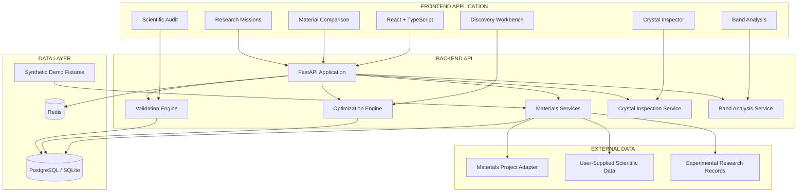

## 5.2 Architectural layers

### Presentation layer

The presentation layer provides:

- Comparison interfaces.
- Scientific property tables.
- Interactive research tools.
- Candidate ranking.
- Validation findings.
- Research missions.

### API layer

FastAPI provides structured HTTP endpoints for:

- Material operations.
- Scientific analysis.
- Optimization.
- Crystal inspection.
- Electronic band analysis.
- Research validation.

### Domain services

The domain services implement scientific and application logic independently from the frontend.

Examples:

- `materials_optimizer.py`
- `crystal_inspector.py`
- `band_ingest.py`
- Research validation modules.

### Data layer

The data layer handles structured material records, user research records, and demo datasets.

The architecture supports PostgreSQL or SQLite according to the deployment environment. Redis is available as an optional caching layer.

## 5.3 Request lifecycle

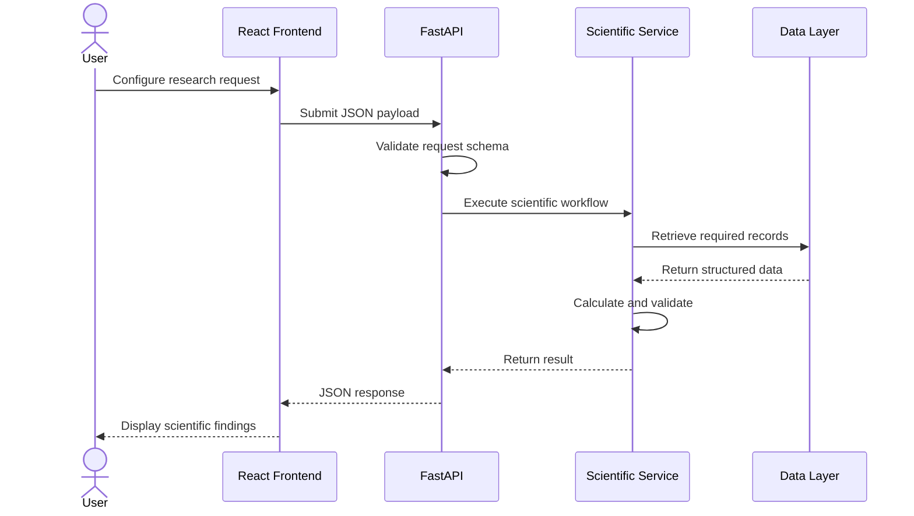

---

# 6. TECHNOLOGY STACK

## 6.1 Frontend

| Technology | Responsibility |
|---|---|
| React | Component-based user interface |
| TypeScript | Type-safe application logic |
| Vite | Frontend development and bundling |
| CSS | Responsive visual system |
| Three.js | 3D visualization capabilities |
| Fetch API | Backend communication |

## 6.2 Backend

| Technology | Responsibility |
|---|---|
| Python | Scientific application logic |
| FastAPI | REST API framework |
| Pydantic | Request validation |
| NumPy | Numerical computation where applicable |
| pymatgen | Materials science and crystal structure tooling |
| pytest | Backend testing |

## 6.3 Data infrastructure

| Technology | Responsibility |
|---|---|
| PostgreSQL | Persistent relational data |
| SQLite | Lightweight local development database |
| Redis | Optional caching and temporary state |
| JSON | Structured fixtures and configuration |
| Materials Project | Optional computational materials data source |

## 6.4 Why this stack?

The frontend is built around reusable components and typed interfaces.

The backend separates scientific calculations from user-interface logic.

Python is suitable for scientific data processing, while FastAPI provides a lightweight API layer that can expose research services to the frontend.

The architecture can expand as the project grows without requiring every scientific feature to be implemented inside the React application.

---

# 7. APPLICATION ARCHITECTURE

## 7.1 Frontend organization

A representative application structure is:

```text
src/
|
+-- components/
|   |
|   +-- materials/
|   |   +-- MaterialCard.tsx
|   |   +-- MaterialComparison.tsx
|   |   +-- PropertyTable.tsx
|   |
|   +-- expansion/
|   |   +-- CrystalBandIngestionLab.tsx
|   |   +-- MaterialsDiscoveryWorkbench.tsx
|   |   +-- ResearchWorkbench.tsx
|   |
|   +-- missions/
|   |   +-- MissionCard.tsx
|   |   +-- MissionProgress.tsx
|
+-- expansion/
|   |
|   +-- pages/
|   |   +-- page-101...page-200
|   |   +-- page-201...page-300
|   |   +-- page-301...page-400
|   |   +-- page-401...page-500
|   |   +-- registry-501-600.ts
|   |   +-- evaluate-v6-rules.ts
|   |
|   +-- missions/
|       +-- v6-missions.ts
|
+-- services/
|   +-- api.ts
|   +-- materials.ts
|
+-- App.tsx
+-- main.tsx
```

## 7.2 Backend organization

```text
backend/
|
+-- app/
|   |
|   +-- main.py
|   |
|   +-- routers/
|   |   +-- materials.py
|   |   +-- expansion.py
|   |
|   +-- services/
|   |   +-- crystal_inspector.py
|   |   +-- band_ingest.py
|   |   +-- materials_optimizer.py
|   |
|   +-- fixtures/
|       +-- materials_demo.json
|       +-- v6_materials_demo.json
|
+-- tests/
|   +-- test_materials.py
|   +-- test_expansion.py
|   +-- test_v6_materials_optimizer.py
|
+-- requirements.txt
```

## 7.3 Modularity

Scientific services should not depend on React components.

For example:

```text
React component
      |
      v
FastAPI endpoint
      |
      v
Pydantic validation
      |
      v
Scientific service
      |
      v
Structured result
```

This design allows the same scientific service to support:

- The web application.
- Automated tests.
- Future mobile applications.
- Research integrations.
- Command-line workflows.

---

# 8. MATERIALS DATA ARCHITECTURE

## 8.1 Material records

A material record represents a candidate material and its available scientific properties.

A conceptual record:

```json
{
  "material_id": "DEMO-SI-001",
  "formula": "Si",
  "name": "Silicon",
  "properties": {
    "band_gap": {
      "value": null,
      "unit": "eV",
      "status": "unavailable"
    },
    "density": {
      "value": null,
      "unit": "g/cm3",
      "status": "unavailable"
    }
  },
  "provenance": {
    "source": null,
    "method": null,
    "retrieved_at": null
  }
}
```

The example intentionally uses unavailable values rather than inventing scientific data.

## 8.2 Property record model

Each property should ideally be represented with:

| Field | Description |
|---|---|
| `property_key` | Canonical property identifier |
| `value` | Numeric or structured value |
| `unit` | Associated physical unit |
| `uncertainty` | Reported uncertainty when available |
| `method` | Experimental or computational method |
| `conditions` | Temperature, pressure, phase, and other conditions |
| `source` | Data source or publication |
| `status` | Available, unavailable, estimated, or unverified |

## 8.3 Evidence types

BAND FOR BAND distinguishes between evidence categories.

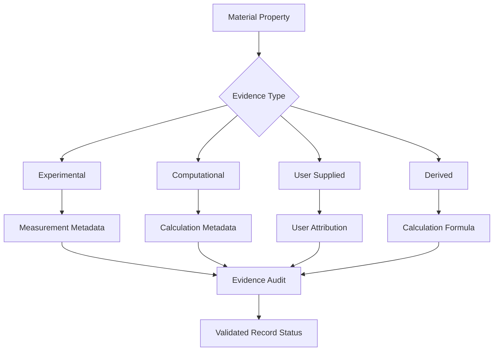

The platform should never treat the presence of a value as equivalent to independent scientific verification.

## 8.4 Missing data policy

Missing values must remain missing.

For example:

```json
{
  "band_gap": null,
  "band_gap_status": "unavailable"
}
```

This is preferable to inserting:

```json
{
  "band_gap": 0
}
```

A missing band gap does not mean the material has a zero band gap.

This distinction is especially important for candidate screening.

---

# 9. MATERIALS COMPARISON ENGINE

## 9.1 Purpose

The comparison engine allows users to investigate multiple materials across the same set of scientific properties.

Its purpose is to support exploration, not to produce a universal ranking.

## 9.2 Comparison workflow

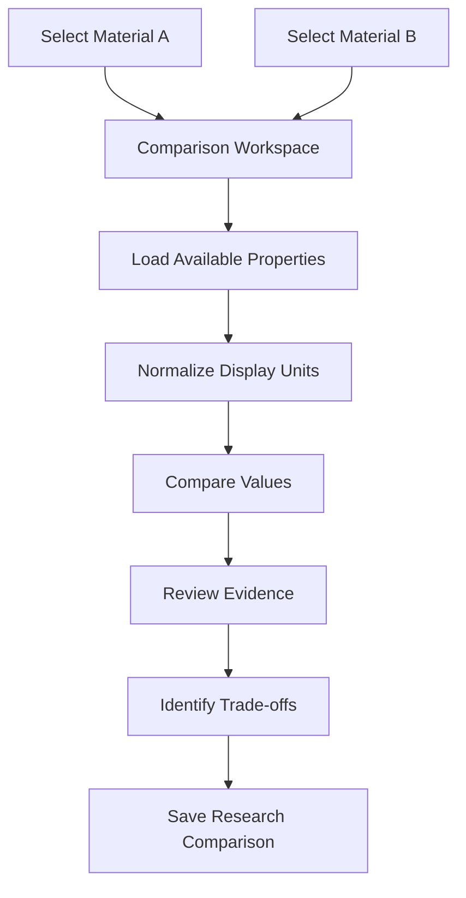

## 9.3 Property comparison

A comparison should include:

- Property name.
- Material A value.
- Material B value.
- Unit.
- Evidence type.
- Measurement or calculation conditions.
- Missing-data indicator.
- Uncertainty where available.

## 9.4 Unit consistency

Values should not be compared until their units are understood.

For example:

- Energy: eV versus meV.
- Length: Å versus nm.
- Temperature: K versus °C.
- Density: g/cm³ versus kg/m³.

The display layer may convert units, but it should preserve the original source value and unit for traceability.

## 9.5 Application-specific comparisons

The same materials can have different rankings depending on the application.

Examples:

| Application | Important properties |
|---|---|
| Power electronics | Band gap, breakdown field, thermal conductivity |
| Photovoltaics | Band gap, absorption, carrier transport |
| Thermoelectrics | Seebeck coefficient, conductivity, thermal conductivity |
| LEDs | Band gap, optical properties, defect characteristics |
| Structural materials | Elastic moduli, density, thermal stability |

These are illustrative property groupings. Actual selection requires application-specific constraints and validation.

---

# 10. MULTI-OBJECTIVE OPTIMIZATION

## 10.1 Overview

The V6 optimization engine evaluates material candidates against multiple objectives.

Users can configure:

- Property key.
- Direction.
- Weight.
- Candidate dataset.
- Optional uncertainty information.

The engine returns:

- Candidate scores.
- Objective-level utilities.
- Ranking.
- Pareto-optimal flags.
- Excluded incomplete candidates.
- Objective ranges.
- Scientific limitations.

## 10.2 Optimization problem

Suppose there are \(n\) candidate materials and \(m\) objectives.

Let:

\[
x_{ij}
\]

represent the value of objective \(j\) for candidate \(i\).

Each objective has:

- A direction \(d_j\).
- A positive weight \(w_j\).

The platform supports:

- Maximization.
- Minimization.

## 10.3 Min-max normalization

For a maximization objective:

\[
u_{ij} =
\frac{x_{ij}-x_{j,\min}}
{x_{j,\max}-x_{j,\min}}
\]

For a minimization objective:

\[
u_{ij} =
1-
\frac{x_{ij}-x_{j,\min}}
{x_{j,\max}-x_{j,\min}}
\]

where:

- \(x_{j,\min}\) is the minimum observed value.
- \(x_{j,\max}\) is the maximum observed value.
- \(u_{ij}\) is the normalized utility.

When every candidate has the same value for an objective, the implementation assigns equal utility rather than dividing by zero.

## 10.4 Weighted utility score

The weighted score is:

\[
S_i =
\frac{
\sum_{j=1}^{m}w_j u_{ij}
}{
\sum_{j=1}^{m}w_j
}
\]

The displayed percentage is:

\[
S_i^{(\%)}=100S_i
\]

The score is relative to the selected candidate set.

It is not an intrinsic material property.

## 10.5 Example

A user wants to compare four hypothetical materials.

Objectives:

| Objective | Direction | Weight |
|---|---|---:|
| Band gap | Maximize | 1.0 |
| Thermal conductivity | Maximize | 0.8 |
| Density | Minimize | 0.5 |

The engine calculates normalized utilities and weighted scores.

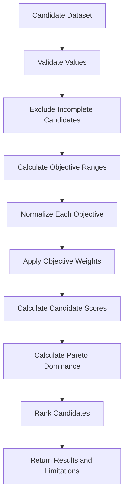

## 10.6 Missing data handling

If a candidate is missing one or more required objective values, it is excluded from the complete-data ranking.

The system reports:

- Candidate identifier.
- Missing property keys.
- Exclusion reason.

It does not silently substitute zero or fabricate a value.

## 10.7 Uncertainty-adjusted screening

V6 also returns a heuristic uncertainty-adjusted score.

The implementation calculates a normalized uncertainty relative to the observed objective range.

The adjustment is:

\[
S_{i,\mathrm{adjusted}}
=
\max(0,S_i-U_i)
\]

where \(U_i\) is the weighted normalized uncertainty diagnostic.

This is a conservative screening heuristic, not a calibrated probability of success or a formal Bayesian posterior.

It should not be interpreted as a confidence interval.

## 10.8 Optimization limitations

Min-max normalization has limitations:

- Outliers can distort objective ranges.
- Scores depend on the selected candidates.
- Objective weights encode user preferences.
- Different candidate datasets can produce different rankings.
- Incomplete candidates are excluded.
- A high score does not prove application suitability.

For this reason, the platform exposes the ranking methodology and limitations alongside the results.

---

# 11. PARETO FRONTIER ANALYSIS

## 11.1 Why Pareto analysis?

Weighted scoring can hide important trade-offs.

A candidate can have a lower weighted score while still being scientifically interesting because it performs exceptionally well on one objective.

Pareto analysis identifies candidates that cannot be improved in one objective without worsening at least one other objective, given the selected objective directions.

## 11.2 Dominance definition

Candidate \(A\) dominates candidate \(B\) if:

1. A is at least as good as B on every objective.
2. A is strictly better than B on at least one objective.

For maximization:

\[
A_j \geq B_j
\]

For minimization:

\[
A_j \leq B_j
\]

At least one inequality must be strict.

## 11.3 Pareto-front workflow

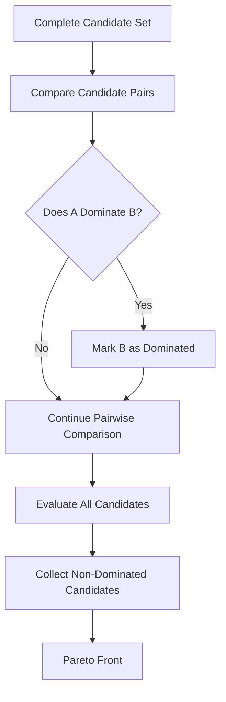

## 11.4 Interpreting the result

A Pareto-optimal candidate is not automatically the best candidate for a specific engineering application.

It means only that no other candidate in the supplied complete dataset dominates it under the chosen objectives.

A researcher must still consider:

- Application requirements.
- Processing constraints.
- Stability.
- Cost.
- Experimental evidence.
- Manufacturing limitations.
- Reliability.
- Uncertainty.

## 11.5 Future visualization

The architecture can support:

- Two-objective scatter plots.
- Three-objective 3D plots.
- Parallel coordinate charts.
- Interactive objective weighting.
- Pareto-front comparison.
- Candidate filtering.

---

# 12. UNCERTAINTY AND SCIENTIFIC VALIDATION

## 12.1 Why uncertainty matters

Scientific values are not always exact.

Experimental measurements may include:

- Instrument uncertainty.
- Sample variation.
- Measurement repeatability.
- Environmental variation.
- Calibration uncertainty.

Computational results may include:

- Model approximation.
- Functional selection.
- Basis-set convergence.
- Pseudopotential choice.
- Numerical convergence.
- Structural assumptions.

BAND FOR BAND provides an evidence and uncertainty framework for keeping these distinctions visible.

## 12.2 Uncertainty metadata

A property can include:

```json
{
  "property": "thermal_conductivity",
  "value": 120.0,
  "unit": "W/mK",
  "uncertainty": 5.0,
  "evidence_type": "experimental",
  "conditions": {
    "temperature_K": 300
  }
}
```

This is an illustrative data structure, not a real measurement record.

## 12.3 Uncertainty propagation

For independent variables and a derived quantity \(f\), first-order uncertainty propagation can be represented as:

\[
\sigma_f^2
\approx
\sum_i
\left(
\frac{\partial f}{\partial x_i}
\right)^2
\sigma_i^2
\]

For correlated variables, covariance terms must also be included:

\[
\sigma_f^2
\approx
\sum_i
\left(
\frac{\partial f}{\partial x_i}
\right)^2
\sigma_i^2
+
2\sum_{i<j}
\frac{\partial f}{\partial x_i}
\frac{\partial f}{\partial x_j}
\operatorname{Cov}(x_i,x_j)
\]

The validity of this approximation depends on the function, uncertainty magnitude, and variable distributions.

## 12.4 Scientific validation categories

The platform's validation registry covers:

| Category | Validation focus |
|---|---|
| Electronic | Band gaps, Fermi levels, effective masses |
| Crystal | Lattice parameters, angles, volume |
| Thermal | Conductivity, heat capacity, temperature |
| Transport | Mobility, resistivity, conductivity |
| Optical | Refractive index and dielectric metadata |
| Phonon | Frequency and imaginary-mode metadata |
| Mechanical | Elastic moduli and Poisson ratio |
| Defects | Defect energy and concentration |
| Provenance | Source and method information |
| Experimental | Sample and measurement conditions |
| Units | Unit availability and consistency metadata |
| Reproducibility | Software and dataset versions |

## 12.5 Validation severity

Each finding has a severity:

- `info`
- `warning`
- `error`

A validation failure does not automatically mean that a scientific value is false.

It means that the record did not satisfy the configured data-quality rule.

## 12.6 Validation workflow

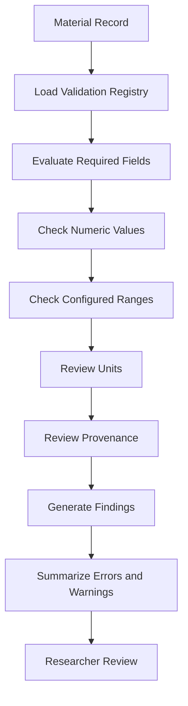

---

# 13. CRYSTAL STRUCTURE INSPECTOR

## 13.1 Purpose

Crystal structure information is fundamental to understanding material properties.

The crystal inspector supports a workflow for examining a supplied CIF file and extracting selected crystallographic information.

CIF stands for Crystallographic Information File.

## 13.2 Supported input

The inspector accepts CIF text containing:

- Unit cell lengths.
- Unit cell angles.
- Fractional atomic coordinates.
- Atomic site information.

## 13.3 Crystallographic coordinates

A fractional coordinate describes a position relative to the unit cell basis vectors.

For lattice vectors:

\[
\vec{a},\vec{b},\vec{c}
\]

a fractional coordinate:

\[
(u,v,w)
\]

maps to Cartesian coordinates:

\[
\vec{r}=u\vec{a}+v\vec{b}+w\vec{c}
\]

## 13.4 Unit cell volume

For lattice lengths \(a,b,c\) and angles \(\alpha,\beta,\gamma\):

\[
V =
abc
\sqrt{
1-\cos^2\alpha-\cos^2\beta-\cos^2\gamma
+2\cos\alpha\cos\beta\cos\gamma
}
\]

The angles must be interpreted consistently in the calculation.

## 13.5 Inspection workflow

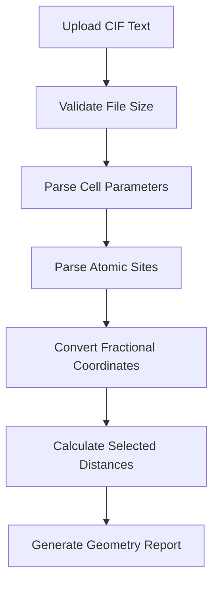

## 13.6 Important implementation limitations

The implemented inspector is a deliberately limited CIF parser.

It does not claim to implement the complete CIF specification.

In particular, it does not provide:

- Complete CIF grammar support.
- Full symmetry expansion.
- Disorder resolution.
- Occupancy normalization.
- Independent source verification.

The neighboring-image search used for distance inspection is a finite search, not a general proof that every possible periodic structural configuration has been resolved.

For advanced crystallographic workflows, full crystallographic software libraries should be used.

---

# 14. ELECTRONIC BAND STRUCTURE ANALYSIS

## 14.1 Purpose

The band analyzer accepts supplied k-point coordinates and energy values to calculate selected electronic structure diagnostics.

It is intended to help users inspect and compare existing band data.

It is not a density functional theory calculation engine.

## 14.2 Inputs

The analysis accepts:

- K-point coordinates.
- Band energy arrays.
- Fermi level.
- Source label.

Each k-point should have an associated band-energy row.

## 14.3 Band extrema

The valence band maximum is:

\[
E_\mathrm{VBM}
=
\max(E_\mathrm{occupied})
\]

The conduction band minimum is:

\[
E_\mathrm{CBM}
=
\min(E_\mathrm{unoccupied})
\]

When occupation information is unavailable, the system must not silently invent occupied-state classifications.

The interpretation of the Fermi level and energy arrays must follow the supplied dataset's convention.

## 14.4 Sampled gap

The sampled energy gap is:

\[
E_g =
E_\mathrm{CBM}
-
E_\mathrm{VBM}
\]

The distinction between a path-sampled gap and a true global fundamental gap is important.

A band path may fail to sample the actual global extrema.

## 14.5 Direct versus indirect gap

A direct gap occurs when the relevant valence and conduction extrema occur at the same crystal momentum.

An indirect gap occurs when they occur at different crystal momenta.

The distinction is physically important for optical transitions.

## 14.6 Workflow

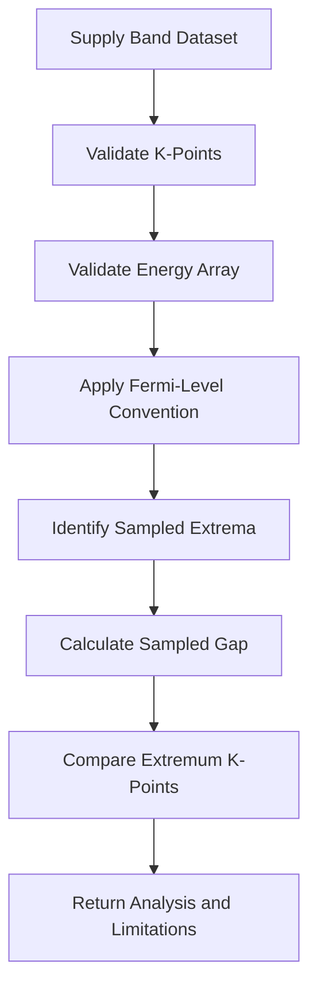

## 14.7 Scientific limitations

The current analyzer does not provide:

- Full Brillouin-zone search.
- Band interpolation.
- Spin-resolved analysis.
- Smearing treatment.
- Occupation inference.
- New electronic structure calculations.

Results must be interpreted in the context of the supplied calculation and sampling path.

---

# 15. RESEARCH MODULE ARCHITECTURE

## 15.1 Overview

BAND FOR BAND includes 500 expansion validation modules, numbered 101–600.

These modules are organized into specialized research categories.

The original 100 screen specifications are separate from the expansion module count.

## 15.2 Module generations

| Generation | Module range | Focus |
|---|---:|---|
| Expansion 01 | 101–200 | Initial research and feature modules |
| Expansion 02 | 201–300 | Scientific workbench and evidence |
| Expansion 03 | 301–400 | Physics and numerical validation |
| Expansion 04 | 401–500 | Crystal and electronic data validation |
| Expansion 05 | 501–600 | Materials discovery and validation |

The module numbering reflects the project's expansion architecture.

## 15.3 V6 registry

The V6 registry contains modules 501–600.

These include checks for:

- Band gap availability.
- Fermi level validity.
- Carrier mobility.
- Conductivity.
- Thermal conductivity.
- Density.
- Formation energy.
- Crystal lattice parameters.
- Unit cell volume.
- Space group metadata.
- Chemical composition.
- Calculation methods.
- Computational settings.
- Experimental conditions.
- Uncertainty metadata.
- Units.
- Optical properties.
- Phonon properties.
- Mechanical properties.
- Defect properties.
- Dataset reproducibility.
- Research attribution.

## 15.4 Rule execution

Each rule is represented by structured metadata:

```typescript
interface V6Rule {
  id: number;
  key: string;
  title: string;
  category: string;
  type: V6RuleType;
  severity: V6Severity;
  description: string;
  minimum?: number;
  maximum?: number;
}
```

The evaluator applies the corresponding rule to a material record.

## 15.5 Example finding

```json
{
  "moduleId": 503,
  "key": "band_gap",
  "title": "Band Gap Non-Negativity",
  "category": "Electronic",
  "severity": "error",
  "passed": true,
  "message": "Value is non-negative."
}
```

## 15.6 Why a registry?

A registry provides a common framework for:

- Consistent rule definitions.
- Module discovery.
- Category filtering.
- Automated evaluation.
- Research mission integration.
- Progress tracking.
- Future module expansion.

It also prevents every validation rule from requiring its own independent frontend implementation.

---

# 16. GAMIFICATION AND RESEARCH MISSIONS

## 16.1 Scientific learning through challenges

BAND FOR BAND incorporates game mechanics to encourage structured exploration.

The goal is not to gamify scientific truth.

Instead, the platform gamifies the process of asking questions, comparing materials, investigating evidence, and completing research workflows.

## 16.2 Mission architecture

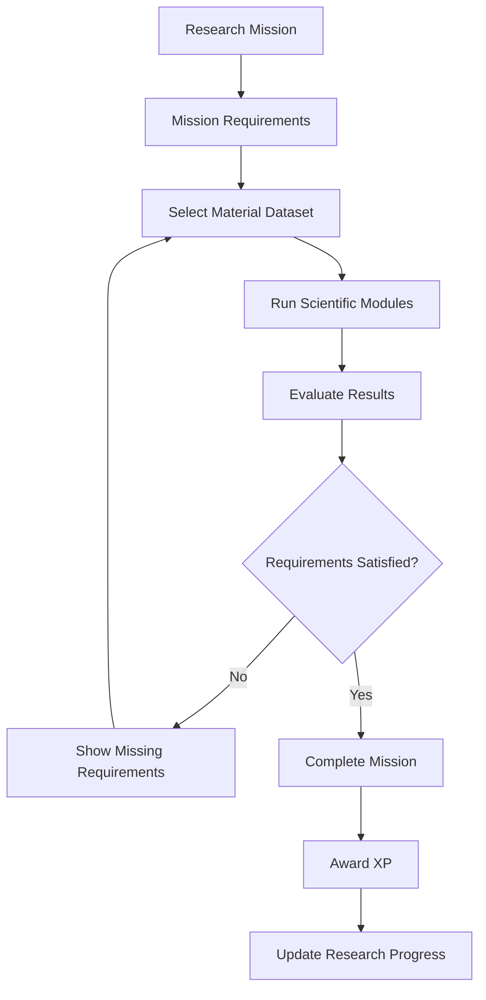

## 16.3 Mission categories

- Discovery.
- Electronic properties.
- Crystal structure.
- Optimization.
- Uncertainty.
- Provenance.
- Computational methods.
- Thermal properties.
- Optical properties.
- Phonons.
- Defects.
- Mechanical properties.
- Experimental validation.
- Reproducibility.

## 16.4 Example missions

| Mission | Challenge |
|---|---|
| Candidate Explorer | Build a candidate dataset |
| Band Gap Investigator | Compare electronic properties |
| Crystal Architect | Validate lattice geometry |
| Pareto Frontier | Identify non-dominated candidates |
| Uncertainty Detective | Audit uncertainty metadata |
| Evidence Collector | Inspect scientific provenance |
| DFT Detective | Review calculation metadata |
| Thermal Explorer | Compare thermal properties |
| Optical Investigator | Review optical metadata |
| Phonon Researcher | Inspect phonon information |
| Defect Engineer | Evaluate defect records |
| Mechanical Materials Lab | Validate elastic properties |
| Unit Guardian | Identify missing units |
| Experiment Tracker | Review sample conditions |
| Reproducibility Challenge | Inspect dataset and software metadata |
| Research Reviewer | Complete a quality review |
| Transport Specialist | Audit carrier transport |
| Composition Analyst | Inspect composition records |
| Optimization Strategist | Explore weight sensitivity |
| Discovery Champion | Complete an integrated research workflow |

## 16.5 XP system

Missions award experience points according to their configured difficulty.

Example difficulty tiers:

| Difficulty | Example XP |
|---|---:|
| Beginner | 100–120 |
| Intermediate | 150–180 |
| Advanced | 220–260 |
| Final challenge | 500 |

XP reflects game progression, not scientific quality or research validity.

## 16.6 Future game mechanics

Potential additions include:

- Weekly materials challenges.
- Research leaderboards.
- Multiplayer comparison battles.
- Custom research missions.
- Classroom competitions.
- Material application challenges.
- Collaborative discovery boards.

---

# 17. API REFERENCE

## 17.1 API architecture

The FastAPI backend exposes scientific services through HTTP endpoints.

The API layer is responsible for:

1. Receiving structured requests.
2. Validating request schemas.
3. Calling scientific services.
4. Handling errors.
5. Returning structured responses.

## 17.2 V6 optimization endpoint

### `POST /api/v6/materials/optimize`

Purpose:

Run multi-objective materials screening.

Example request:

```json
{
  "objectives": [
    {
      "key": "band_gap",
      "direction": "maximize",
      "weight": 1.0
    },
    {
      "key": "density",
      "direction": "minimize",
      "weight": 0.5
    }
  ],
  "candidates": [
    {
      "id": "A",
      "name": "Synthetic Material A",
      "values": {
        "band_gap": 2.1,
        "density": 4.2
      },
      "uncertainties": {
        "band_gap": 0.05,
        "density": 0.1
      }
    },
    {
      "id": "B",
      "name": "Synthetic Material B",
      "values": {
        "band_gap": 1.6,
        "density": 5.1
      },
      "uncertainties": {
        "band_gap": 0.03,
        "density": 0.2
      }
    }
  ]
}
```

Example response structure:

```json
{
  "engine": "BAND FOR BAND V6",
  "method": "Weighted min-max utility and Pareto dominance",
  "objective_ranges": {},
  "objectives": [],
  "ranked_candidates": [],
  "pareto_front": [],
  "excluded_candidates": [],
  "candidate_count": 2,
  "excluded_count": 0,
  "limitations": []
}
```

## 17.3 Crystal inspection endpoint

### `POST /api/v3/crystal/inspect`

Purpose:

Inspect supported CIF input and return selected crystallographic geometry information.

Request fields include:

- CIF text.
- Distance cutoff.

The parser applies input size and site-count limits.

The output should be interpreted according to the parser's documented limitations.

## 17.4 Electronic band analysis endpoint

### `POST /api/v3/bands/analyze`

Purpose:

Analyze user-supplied k-point and band-energy arrays.

Request fields include:

- Title.
- Source label.
- Fermi level.
- K-point coordinates.
- Energy arrays.

The endpoint reports sampled band extrema and gap diagnostics.

## 17.5 API error handling

The API should use structured status codes.

| Status | Meaning |
|---|---|
| 200 | Successful request |
| 400 | Invalid request or unsupported operation |
| 404 | Resource not found |
| 422 | Request validation failure |
| 500 | Unexpected server error |

Clients should distinguish validation errors from server failures.

---

# 18. DATA SOURCES AND INTEGRATIONS

## 18.1 Materials Project

BAND FOR BAND includes an optional Materials Project integration concept for retrieving computational materials data.

Materials Project is an important source of computed materials properties and structural information.

The adapter is designed to keep external data retrieval separate from the scientific comparison and optimization services.

## 18.2 Integration architecture


## 18.3 API credentials

External API credentials should be stored in environment variables.

Example:

```env
MATERIALS_PROJECT_API_KEY=your_api_key
```

Do not commit real API credentials to GitHub.

## 18.4 Source attribution

External records should preserve, where available:

- Source name.
- Source identifier.
- Retrieval date.
- Data version.
- Calculation method.
- Relevant calculation settings.

## 18.5 Experimental data

Experimental measurements should be distinguished from computational results.

The platform should preserve:

- Measurement method.
- Sample identifier.
- Temperature.
- Pressure.
- Sample purity.
- Replicate count.
- Measurement uncertainty.
- Publication or source attribution.

## 18.6 Synthetic demo data

Demo fixtures are used to demonstrate application functionality without requiring external API access.

Synthetic values must be clearly labelled.

They must never be presented as experimental measurements or authoritative computational results.

---

# 19. INSTALLATION AND LOCAL DEVELOPMENT

## 19.1 Prerequisites

Recommended development environment:

- Python 3.10 or newer, compatible with project dependencies.
- Node.js and npm.
- Git.
- A terminal.
- Optional PostgreSQL installation.
- Optional Redis installation.
- Optional Materials Project API key.

Use the dependency versions specified by the repository's package and requirements files.

## 19.2 Clone the repository

```bash
git clone https://github.com/lucylow/band-for-band.git

cd band-for-band
```

## 19.3 Backend setup

Create a virtual environment:

```bash
cd backend

python -m venv .venv
```

Activate it on macOS or Linux:

```bash
source .venv/bin/activate
```

Activate it on Windows:

```powershell
.venv\Scripts\activate
```

Install dependencies:

```bash
pip install -r requirements.txt
```

## 19.4 Start the backend

```bash
PYTHONPATH=. uvicorn app.main:app --reload
```

The development API should be available at:

```text
http://localhost:8000
```

FastAPI's interactive documentation is typically available at:

```text
http://localhost:8000/docs
```

## 19.5 Frontend setup

Open a second terminal:

```bash
cd src
```

If the frontend package file is in the repository root, return to that root before installing:

```bash
cd ..
npm install
```

Start the development server:

```bash
npm run dev
```

Use the URL displayed by Vite.

## 19.6 Environment configuration

Create a `.env` file using the repository's supported environment variable names.

Example:

```env
VITE_API_URL=http://localhost:8000

MATERIALS_PROJECT_API_KEY=
```

The frontend API URL should point to the FastAPI backend.

The external API key can remain empty when using local synthetic demo data.

## 19.7 Development workflow

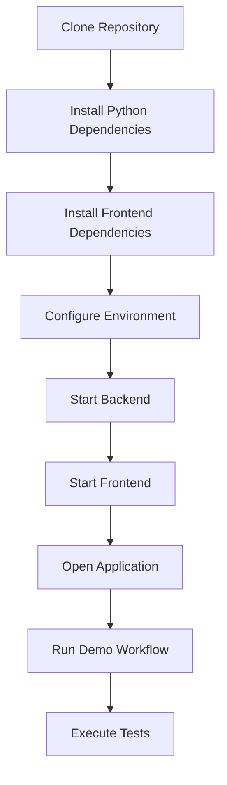

---

# 20. TESTING, DEPLOYMENT, AND FUTURE DEVELOPMENT

## 20.1 Testing strategy

BAND FOR BAND uses a layered testing approach.

### Backend unit tests

Test individual scientific services.

Examples:

- Materials optimization.
- Candidate validation.
- Pareto dominance.
- Missing-data handling.
- Uncertainty validation.
- Crystal geometry.
- Band-data input validation.

### API integration tests

Test:

- Endpoint availability.
- Request validation.
- Response structure.
- Error handling.
- Invalid input rejection.

### Frontend tests

The frontend should be tested for:

- Component rendering.
- Form validation.
- API response handling.
- Loading states.
- Empty states.
- Error states.
- Responsive layout.
- Candidate ranking display.

## 20.2 Backend test commands

```bash
cd backend

PYTHONPATH=. pytest -q
```

For detailed test output:

```bash
PYTHONPATH=. pytest -v
```

For coverage, if pytest-cov is installed:

```bash
PYTHONPATH=. pytest \
  --cov=app \
  --cov-report=term-missing
```

## 20.3 Scientific validation tests

The optimization engine should include tests for:

- Duplicate candidate IDs.
- Duplicate objective keys.
- Invalid optimization directions.
- Non-finite property values.
- Negative uncertainty.
- Missing objective data.
- Constant objective ranges.
- Pareto-front correctness.
- Ranking stability under fixed input.

## 20.4 Deployment architecture

A production deployment can separate frontend, backend, and data services.

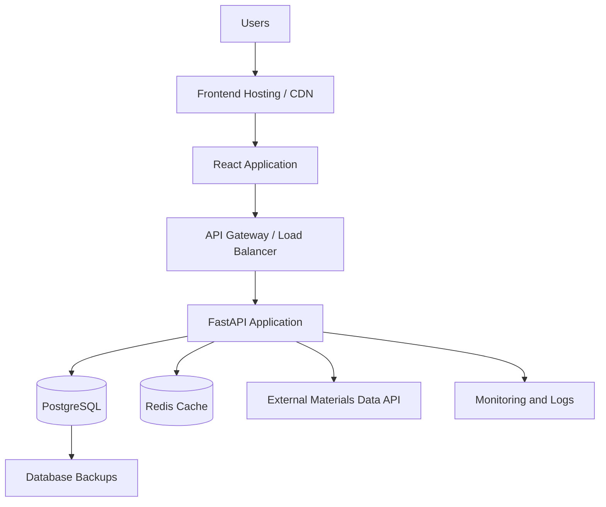

## 20.5 Production considerations

Before public deployment:

- Configure HTTPS.
- Store secrets securely.
- Restrict database access.
- Configure CORS.
- Add authentication and authorization.
- Add request rate limiting.
- Validate upload size and file content.
- Configure structured logging.
- Monitor API performance.
- Back up persistent research records.
- Test database migrations.
- Review third-party API usage terms.

## 20.6 Security

Scientific file uploads and external API integrations require careful validation.

Recommended safeguards include:

- Maximum upload sizes.
- Allowed file types.
- Input validation.
- API credential protection.
- No hard-coded secrets.
- Database access controls.
- Safe error messages.
- Dependency updates.
- Audit logging.

## 20.7 Performance

Potential performance improvements include:

- Caching frequently requested material records.
- Database indexes for material identifiers.
- Pagination for large material collections.
- Background processing for expensive workflows.
- Efficient pairwise optimization algorithms.
- Lazy loading of large research interfaces.
- Avoiding repeated external API calls.

## 20.8 Scalability

The modular service architecture supports future separation into independent services.

For example:

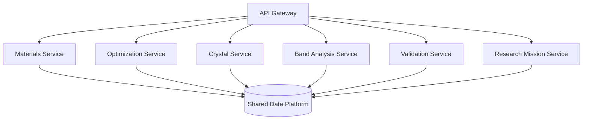

This is a possible future deployment architecture, not a requirement for the current monolithic FastAPI deployment.

## 20.9 Future roadmap

### Phase 1 — Scientific data foundation

- Improve property schema consistency.
- Expand source attribution.
- Improve unit normalization.
- Add structured experimental conditions.
- Add dataset versioning.

### Phase 2 — Advanced materials discovery

- Additional optimization algorithms.
- Constraint-based candidate filtering.
- Sensitivity analysis.
- More advanced uncertainty propagation.
- Multi-objective visualization.
- Candidate similarity analysis.

### Phase 3 — Computational materials integration

- Expand Materials Project workflows.
- Add additional computational dataset adapters.
- Improve band structure visualization.
- Add phonon dataset inspection.
- Improve crystallographic support.
- Add calculation reproducibility metadata.

### Phase 4 — Research collaboration

- Research project workspaces.
- Shared material comparisons.
- Collaborative research missions.
- Exportable research reports.
- Citation and evidence management.
- Team leaderboards.

### Phase 5 — Advanced scientific intelligence

Potential future research directions include:

- Active learning.
- Bayesian optimization.
- Surrogate models.
- Machine-learning property prediction.
- Candidate recommendation.
- Model uncertainty estimation.
- Experimental feedback loops.

These capabilities require separately validated models, datasets, and evaluation procedures. They should not be represented as already available merely because the current optimization engine supports weighted ranking.

---

# SCIENTIFIC INTEGRITY AND LIMITATIONS

BAND FOR BAND is a scientific comparison and decision-support platform.

It is not a replacement for experimental validation, peer-reviewed research, or first-principles computational materials science.

The platform distinguishes between:

- Measured values.
- Computational values.
- User-supplied values.
- Derived values.
- Synthetic demonstration values.
- Unavailable values.

Its optimization scores are relative to the supplied candidate set and configured objectives.

Its Pareto front identifies non-dominated candidates under those objectives.

Its uncertainty-adjusted ranking is a heuristic diagnostic, not a calibrated probability.

Its crystal inspector supports a limited CIF subset.

Its electronic band analyzer analyzes supplied data rather than generating new band structures.

Researchers should consult original sources and validate application-specific requirements before using screening results to make engineering decisions.

---

# CONTRIBUTING

Contributions are welcome.

Potential contribution areas:

- New scientific validation modules.
- Materials property integrations.
- Improved crystal parsing.
- Electronic band visualization.
- Optimization methods.
- Scientific unit validation.
- Research missions.
- Accessibility improvements.
- Test coverage.
- Documentation.

## Contribution workflow

1. Fork the repository.
2. Create a feature branch.
3. Implement the change.
4. Add tests.
5. Update documentation.
6. Submit a pull request.

Example:

```bash
git checkout -b feature/new-material-validation

git add .

git commit -m "Add scientific material validation module"

git push origin feature/new-material-validation
```

Contributions should clearly distinguish scientific facts, assumptions, approximations, and synthetic data.

---

# PROJECT STRUCTURE SUMMARY

| Layer | Main responsibility |
|---|---|
| React frontend | Scientific user experience |
| TypeScript modules | Validation and application logic |
| FastAPI | Backend endpoints |
| Materials services | Material data operations |
| Optimization engine | Candidate ranking and Pareto analysis |
| Crystal inspector | CIF geometry inspection |
| Band analyzer | Supplied band-data analysis |
| Research registry | Scientific validation modules |
| Mission system | Gamified research progression |
| Database | Persistent structured records |
| External adapters | Materials data integrations |

# PROJECT IMPACT

BAND FOR BAND explores a different way to interact with materials science.

Rather than treating materials research as a static table of numbers, it turns scientific comparison into a structured and interactive discovery workflow.

The platform connects:

- Materials science.
- Semiconductor research.
- Computational materials data.
- Experimental evidence.
- Multi-objective optimization.
- Scientific data quality.
- Gamified learning.

Its central idea is simple:

**A material should not win because it has the biggest number. It should be evaluated according to the scientific requirements, evidence, and trade-offs that matter.**

---

# BAND FOR BAND

<p align="center">
  <strong>DISCOVER MATERIALS. COMPARE PROPERTIES. CHALLENGE THE FRONTIER.</strong>
</p>

<p align="center">
  Materials science meets interactive discovery.
</p>

<p align="center">
  <em>Built for researchers, engineers, students, and the next generation of materials innovators.</em>
</p>
